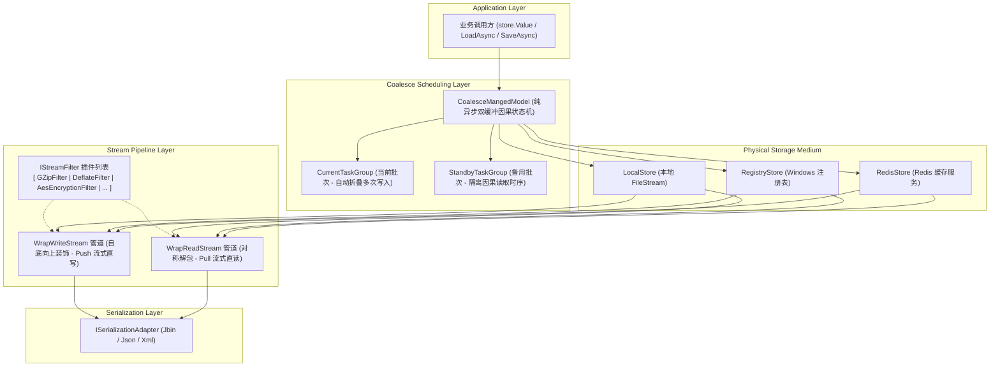

# ApeFree.DataStore

<div align="center">


### 现代化轻量级对象透明持久化与状态管理引擎

[](https://www.nuget.org/packages/ApeFree.DataStore/)
[](LICENSE)
[](#)

</div>

---

## 📖 简介

在传统桌面端（WinForms/WPF/Avalonia）、工控软件、小型服务或工具类应用开发中，持久化配置参数、用户偏好或业务单体聚合模型往往非常繁琐：开发者不得不反复编写 `File.ReadAllText`、加解密中转、序列化反序列化等样板代码；在高频参数调节或并发写入时，还极易引发**磁盘写风暴**与**文件锁冲突**。

**ApeFree.DataStore** 专为解决这一系列痛点而生！它将内存单体对象与底层存储介质（本地磁盘、Windows 注册表、Redis 缓存）完全解耦，提供**极简心智模型（`store.Value` / `store.Load()` / `store.Save()`）**，并在底层内嵌了**零拷贝双向流式过滤器管道**与**双缓冲读写因果合并调度器**。

---

## 🤔 为什么选择 ApeFree.DataStore？

| 痛点场景 | 传统手写方案 / 简易库 | ApeFree.DataStore 3.0.0 解决方案 |
| :--- | :--- | :--- |
| **持久化样板代码** | 随处充斥 `File.WriteAllText(JsonConvert.Serialize(...))`，维护成本高 | 统一抽象为 `IStore<T>` 门面，通过 `store.Value` 直观操作，一键读写 |
| **存储介质切换** | 更换存储目标（如文件改存注册表或 Redis）需重构整个 IO 逻辑 | **介质完全透明**：业务代码仅依赖 `IStore<T>`，换介质仅需替换配置对象 |
| **高频并发写风暴** | 滑块拖拽、高频传感器采样导致磁盘或网络 IO 被打崩、文件锁死 | **内置自适应写折叠（Write Coalescing）**：高频并发写自动合并为单次最终落盘 |
| **时序错乱与脏读** | 并发异步写入未完成时发起读取，容易读到旧数据或损坏的文件 | **读写因果一致性保证（Read-Your-Writes）**：写后的读必定等待并读取写后新值 |
| **压缩与加密扩展** | 算法逻辑与文件读写强耦合，内存中反复多次生成 `byte[]` 和全量 `MemoryStream` | **双向装饰流管道（Decorator Pipeline）**：端到端零全量内存拷贝，插件自由插拔 |
| **工业大数组开销** | JSON 序列化点云/大数组时产生严重的 Base64 膨胀与 GC 暂停 | **深度集成 Jbin 极限性能引擎**：基元数组通过非托管指针零拷贝映射，吞吐提升数倍 |

---

## 🏛️ 核心架构全景



---

## 🔄 格式随心换：全套序列化适配器（ISerializationAdapter）

DataStore 3.0.0 提供了全面的序列化格式支持，用户可以通过 `settings.SerializationAdapter` 一键切换，并支持深度自定义配置。

### 1. Jbin 序列化器（`JbinSerializationAdapter`，默认推荐 ⭐）
**Jbin** 是 ApeFree 生态专属的高性能 JSON 二进制混合序列化协议。它将对象的拓扑骨架以 JSON 表达，而将大型浮点/整型数组、矩阵或结构体外置为连续二进制块，实现直接内存映射。
- **端到端纯流式**：直接向底层流写入，零临时 byte[] 堆分配；
- **内存即时释放**：反序列化后自动 Dispose 释放数据块；
- **多态白名单安全防护**：支持指定受信任的程序集白名单；
- **原生基元数组领域压缩**：针对不同原生数值类型内置专门的时序与位压缩算法（浮点 Gorilla、整型 FoR、长整型 Simple-8b、短整型 Delta+BitPacking），解压过程无需外置解压器，Jbin 帧头自适应感知还原。

```csharp
using ApeFree.DataStore.Adapters;
using ApeFree.Protocols.Json.Jbin;

// 1. 使用 Jbin 默认高性能配置（原生内存块零拷贝）
settings.SerializationAdapter = new JbinSerializationAdapter();

// 2. 启用基元数值数组与字符串领域专有压缩算法（Gorilla 浮点 / FoR 整型 / Simple-8b 长整型 / Dictionary 字符串字典）
settings.SerializationAdapter = JbinSerializationAdapter.CreateWithPrimitiveCompression(
    singleMode: SingleArrayCompressMode.Gorilla,
    doubleMode: DoubleArrayCompressMode.Gorilla,
    int32Mode: Int32ArrayCompressMode.FrameOfReference,
    int64Mode: Int64ArrayCompressMode.Simple8b,
    stringMode: StringArrayCompressMode.Dictionary
);

// 3. 带有多态反序列化安全白名单的配置
settings.SerializationAdapter = new JbinSerializationAdapter(
    typeof(MyModel).Assembly,
    typeof(MyPluginContract).Assembly
);
```

### 2. JSON 序列化器（`JsonSerializationAdapter`）
基于成熟的 `Newtonsoft.Json` 构建，采用纯流式 `JsonTextWriter` 与 `JsonTextReader` 对接，避免内存中生成巨大字符串。
- 支持完整的 `JsonSerializerSettings` 配置（缩进排版、忽略 Null、时间格式化、枚举转换等）。

```csharp
using ApeFree.DataStore.Adapters;
using Newtonsoft.Json;

// 自定义 JSON 配置
var jsonSettings = new JsonSerializerSettings
{
    Formatting = Formatting.Indented,                 // 易读缩进格式
    NullValueHandling = NullValueHandling.Ignore,     // 忽略 null 字段
    DateFormatString = "yyyy-MM-dd HH:mm:ss"          // 自定义日期格式
};

settings.SerializationAdapter = new JsonSerializationAdapter(jsonSettings);
```

### 3. XML 序列化器（`XmlSerializationAdapter`）
基于 .NET 原生 `XmlSerializer` 构建，内置类型序列化器的高并发安全缓存（`ConcurrentDictionary`）。
- 支持自定义根节点名称（`RootName`），满足特定工控协议或旧系统 XML 规范。

```csharp
using ApeFree.DataStore.Adapters;

// 1. 标准 XML 序列化
settings.SerializationAdapter = new XmlSerializationAdapter();

// 2. 指定自定义 XML 根节点名称（如生成 <SystemConfiguration>...</SystemConfiguration>）
settings.SerializationAdapter = new XmlSerializationAdapter("SystemConfiguration");
```

---

## 🛡️ 安全与瘦身：全套流过滤器（IStreamFilter）自由组合

DataStore 3.0.0 彻底废除了旧版死板的三段式结构，将流转换全面抽象为 `IStreamFilter` 管道。**过滤器在 `settings.StreamFilters` 列表中由先到后生效**，写入时顺流压缩/加密，读取时对称解密/解压。

### 1. GZip 压缩过滤器（`GZipStreamFilter`）
采用业界标准的 GZip 算法，支持配置压缩等级：
```csharp
using ApeFree.DataStore.Filters;
using System.IO.Compression;

// 快速压缩（适合高频小数据）
settings.StreamFilters.Add(new GZipStreamFilter(CompressionLevel.Fastest));

// 极限压缩（适合落盘存档或低频大数据）
settings.StreamFilters.Add(new GZipStreamFilter(CompressionLevel.Optimal));
```

### 2. Deflate 压缩过滤器（`DeflateStreamFilter`）
采用 Deflate 无损压缩算法，相较于 GZip 略去文件头尾元数据，体积更精简：
```csharp
using ApeFree.DataStore.Filters;
using System.IO.Compression;

settings.StreamFilters.Add(new DeflateStreamFilter(CompressionLevel.Optimal));
```

### 3. AES 对称加密过滤器（`AesEncryptionStreamFilter`）
对存储数据进行端到端高强度对称加密，磁盘或注册表上绝无明文泄露：
- 支持指定自定义 **密钥（Key）** 与 **初始化向量（IV）**；
- 支持自定义加密模式（`CipherMode`，如 CBC/ECB/CFB）与填充模式（`PaddingMode`，如 PKCS7/None/Zeros）。

```csharp
using ApeFree.DataStore.Filters;
using System.Security.Cryptography;
using System.Text;

byte[] key = Encoding.UTF8.GetBytes("01234567890123456789012345678901"); // 32 字节 (AES-256)
byte[] iv  = Encoding.UTF8.GetBytes("0123456789abcdef");                 // 16 字节

var aesFilter = new AesEncryptionStreamFilter(key, iv)
{
    CipherMode = CipherMode.CBC,
    PaddingMode = PaddingMode.PKCS7
};

settings.StreamFilters.Add(aesFilter);
```

### 4. 复合多层管道实战（按需自由组合）

流式过滤器的执行顺序严格取决于你在列表中的添加顺序：

#### 方案 A：先压缩、后加密（推荐最佳实践）
先通过压缩减少数据体积并消除明文统计特征（增加信息熵），再进行加密，既大幅提升加密速度，又显著增强抗密文分析能力：
```csharp
// 管道定义：[0] GZip -> [1] AES
settings.StreamFilters.Add(new GZipStreamFilter(CompressionLevel.Optimal));
settings.StreamFilters.Add(new AesEncryptionStreamFilter(key, iv));
```

#### 方案 B：仅加密不压缩 / 仅压缩不加密
只需向列表中添加对应的单一过滤器，不再强制要求配置冗余的默认占位项。

### 5. 自定义扩展专属 StreamFilter

只需实现 `IStreamFilter` 接口，即可无缝融入 DataStore 管道：
```csharp
public class MyAuditFilter : IStreamFilter
{
    public Stream WrapWriteStream(Stream outputStream)
    {
        Console.WriteLine($"[Audit] 开始写入数据，时间: {DateTime.Now}");
        return outputStream; // 可返回自定义计数流或日志流
    }

    public Stream WrapReadStream(Stream inputStream)
    {
        Console.WriteLine($"[Audit] 开始读取数据，时间: {DateTime.Now}");
        return inputStream;
    }

    public void Dispose() { }
}
```

---

## 💾 介质任你选：存储介质与完整配置字典

### 1. 本地文件存储（`LocalStore<T>`）
最常用的存储介质。自动处理多级目录创建，直接对接物理 `FileStream`。

```csharp
using ApeFree.DataStore;
using ApeFree.DataStore.Local;

var settings = new LocalStoreAccessSettings("./data/config.dat");
var store = StoreFactory.Factory.CreateLocalStore<MyConfig>(settings);
```

### 2. Windows 注册表存储（`RegistryStore<T>`）
*需要引用 `ApeFree.DataStore.Registry` 包*。专用于 Windows 平台下的系统注册表键值持久化，结合 AES 加密可用于商业软件授权、机器指纹或防篡改配置。

```csharp
using ApeFree.DataStore;
using ApeFree.DataStore.Registry;
using Microsoft.Win32;

var settings = new RegistryStoreAccessSettings(
    RegistryHive.CurrentUser,           // 注册表根节点 (CurrentUser / LocalMachine)
    @"Software\MyCompany\MyApp\Config", // 子项路径
    "CoreSettings"                      // 值名称 (Value Key)
);

var store = StoreFactory.Factory.CreateRegistryStore<LicenseConfig>(settings);
```

### 3. Redis 远程缓存存储（`RedisStore<T>`）
*需要引用 `ApeFree.DataStore.RedisStore` 包*。将单体业务模型持久化到集中式 Redis 缓存服务器，多客户端可共享加载与保存。

```csharp
using ApeFree.DataStore;
using ApeFree.DataStore.RedisStore;
using ServiceStack.Redis;

var client = new RedisClient("127.0.0.1", 6379);
var settings = new RedisStoreAccessSettings(client, "App:Config:Production");
var store = StoreFactory.Factory.CreateRedisStore<ClusterConfig>(settings);
```

### 4. 核心配置选项字典

| 配置类 | 属性名称 | 类型 | 默认值 | 说明 |
| :--- | :--- | :--- | :--- | :--- |
| **`AccessSettings`** | `SerializationAdapter` | `ISerializationAdapter` | `JbinSerializationAdapter` | 序列化适配器（支持 Jbin / Json / Xml） |
| | `StreamFilters` | `IList<IStreamFilter>` | 空列表 | 流过滤器管道列表，按声明顺序依次包装 |
| **`LocalStoreAccessSettings`** | `SavePath` | `string` | *(必填构造参数)* | 本地持久化文件的物理/相对路径 |
| **`RegistryStoreAccessSettings`** | `BaseKey` | `RegistryHive` | *(必填构造参数)* | 注册表根键（`CurrentUser` 或 `LocalMachine`） |
| | `Path` | `string` | *(必填构造参数)* | 注册表子键路径 |
| | `Key` | `string` | *(必填构造参数)* | 存储的数据项名称（注册表值名） |
| **`RedisStoreAccessSettings`** | `Client` | `IRedisClient` | *(必填构造参数)* | Redis 客户端连接实例 |
| | `Key` | `string` | *(必填构造参数)* | Redis 存储目标键名 |

---

## ⚡ 高并发异步写合并（Coalesce Managed Model）

在工业测控、UI 状态实时跟踪等高频写入场景下，短时间内频繁调用保存会造成灾难性的 IO 竞争。

DataStore 内部内置了**双缓冲读写因果合并调度器**：
- **自动写折叠（Write Coalescing）**：当后台正在执行写盘时，前端连续到来的 100 次 `SaveAsync()` 会被自动合并为**最后 1 次物理写**，但前面等待的所有 100 个 `Task` 均能收到写入完成的成功通知；
- **纯异步零阻塞**：完全基于 `TaskCompletionSource<bool>` 实现非阻塞通知，零消耗后台线程池线程；
- **Read-Your-Writes 因果一致性**：写操作后紧接着发起的读操作，绝不会被抢跑在旧写之前执行，100% 确保读取到写盘后的最新值。

```csharp
// 连续触发 100 次并发写任务，无需担心性能崩溃，内部自动折叠为极少数物理 IO
var tasks = Enumerable.Range(0, 100).Select(i =>
{
    store.Value.Progress = i;
    return store.SaveAsync();
});

await Task.WhenAll(tasks);
```

---

## 📦 安装与包生态

| Nuget 包名 | 说明 | 兼容平台 |
| :--- | :--- | :--- |
| [**`ApeFree.DataStore`**](https://www.nuget.org/packages/ApeFree.DataStore/) | 核心引擎、本地文件存储、流管道、Jbin/Json/Xml 适配器 | `netstandard2.0` / `net8.0` / `net10.0` |
| [**`ApeFree.DataStore.Registry`**](https://www.nuget.org/packages/ApeFree.DataStore.Registry/) | Windows 注册表对象安全存储扩展 | `netstandard2.0` / `net8.0-windows` / `net10.0-windows` |
| [**`ApeFree.DataStore.RedisStore`**](https://www.nuget.org/packages/ApeFree.DataStore.RedisStore/) | Redis 分布式远程对象存储扩展 | `netstandard2.0` / `net8.0` / `net10.0` |

---

## 🖥️ 演示工程与基准测试报告 (Benchmark & Reports)

本项目在 `samples/` 目录下提供了完整的基准评测工程与基础示例工程：

- [**`ApeFree.DataStore.BenchmarkDemo`**](samples/ApeFree.DataStore.BenchmarkDemo/)：**基准性能与大数据存储对比评测系统**
  - **工程路径**：[`samples/ApeFree.DataStore.BenchmarkDemo`](samples/ApeFree.DataStore.BenchmarkDemo/)
  - **运行方式**：支持通过 WinForms 图形化交互界面运行，或通过命令行静默运行：`dotnet run --project samples/ApeFree.DataStore.BenchmarkDemo -f net10.0-windows -- -r`。
- [**`ApeFree.DataStore.Demo`**](samples/ApeFree.DataStore.Demo/)：基础 WinForms 数据实体增删改查与持久化示例（路径：[`samples/ApeFree.DataStore.Demo`](samples/ApeFree.DataStore.Demo/)）。

---

### 📊 基准测试报告 1：高频配置读写性能对比

#### 1. 测试环境与测试方案
- **硬件与运行环境**：Windows x64 / .NET 10.0 Runtime / 本地 NVMe SSD
- **测试数据模型**：[`AppConfig`](samples/ApeFree.DataStore.BenchmarkDemo/Models/ConfigModels.cs)（包含窗体布局、用户设置、近期文件列表与动态字典，单次序列化文本约 2.5 KB）
- **测试负载**：1,000 次连续保存操作，4 线程并发执行，0 ms 模拟间隔（极限压测）
- **对比方案**：
  1. **传统直接读写方案 (`File.WriteAllText + JsonConvert`)**：每次修改配置均全量执行 `JsonConvert.SerializeObject` 并调用操作系统文件 API `File.WriteAllText` 写入磁盘，业务并发采用进程内锁同步；读取配置通过 `File.ReadAllText` 后反序列化。
  2. **`ApeFree.DataStore` 方案**：创建 `LocalStore<AppConfig>` 并配置同构的 `JsonSerializationAdapter`；修改配置调用 `store.SaveAsync()` 经由 `CoalesceMangedModel` 调度器执行异步写合并；读取配置直接访问内存实例 `store.Value`。

#### 2. 实测数据对比表

| 评测维度 / 性能指标 | 传统直接读写 (`File.WriteAllText + Json`) | `ApeFree.DataStore` (Coalesce 模式) | 差异对比 |
| :--- | :--- | :--- | :--- |
| **调用方写入总耗时** | 285.1 ms | **<font color="#d93025">8.0 ms</font>** | **<font color="#d93025">耗时降低 97.2%</font>** |
| **写入吞吐量** | 3,507 ops/s | **<font color="#d93025">125,447 ops/s</font>** | **<font color="#d93025">吞吐量提升约 35 倍</font>** |
| **平均单次保存延迟** | 0.285 ms | **<font color="#d93025">0.008 ms</font>** | **<font color="#d93025">延迟降低 97.2%</font>** |
| **单次配置读取延迟** | 0.878 ms（每次从磁盘读取并解析） | **<font color="#d93025">< 0.0001 ms</font>**（内存直读） | **<font color="#d93025">延迟降低 > 99.9%</font>** |
| **物理磁盘实际刷盘次数** | 1,000 次（每次保存均落盘） | **<font color="#d93025">3 次</font>**（因果自动合并） | **<font color="#d93025">物理 I/O 削减 99.7%</font>** |
| **物理磁盘实际写入数据量** | 809,785 Bytes (~810 KB) | **<font color="#d93025">3,018 Bytes (~3 KB)</font>** | **<font color="#d93025">写入磨损量降低 99.6%</font>** |
| **并发文件锁冲突/异常数** | 0 次（依赖排队锁） | 0 次（无锁 CAS 调度） | 两种方案均未发生锁冲突 |
| **最终落盘数据因果一致性** | 校验通过 | 校验通过 | 100% 数据一致 |

---

### 📊 基准测试报告 2：超大数据单次读写速度与容量大小对比

> [!NOTE]
> **测试工程名称**：`ApeFree.DataStore.BenchmarkDemo`  
> **工程物理路径**：[`samples/ApeFree.DataStore.BenchmarkDemo`](samples/ApeFree.DataStore.BenchmarkDemo/)  
> **复现执行指令**：`dotnet run --project samples/ApeFree.DataStore.BenchmarkDemo -f net10.0-windows -- -r`  
> **压缩体系分工机制说明**：
> 1. **类型层领域压缩（Type Layer）**：由 `JbinPrimitiveArrayConverter` 针对不同基元类型数组执行专有算法（如浮点数采用 Gorilla XOR 时序差分、32位整型采用 Frame of Reference (FoR) 基准帧差分、64位整型采用 Simple-8b 紧凑位打包）。解压过程由 Jbin 帧头自适应感知还原，无需外置解压器；
> 2. **流管道层通用压缩（Stream Filter Layer）**：由 `IStreamFilter`（如 `DeflateStreamFilter`、`GZipStreamFilter`）在物理字节出口处工作；
> 3. **双层复合管道（Composite Pipeline）**：类型层先消除连续数值的数据熵与冗余位，流管道层再做通量压缩，实现体积极限收敛。

#### 1. 数据集 A：海量传感器与 3D 点云时序数据（原生值类型连续大数组）
- **数据结构**：[`PointCloudDataset`](samples/ApeFree.DataStore.BenchmarkDemo/Models/BigDataModels.cs)，包含 50,000 个采样点（`float[] PositionsX, Y, Z` 各 50,000 项，`double[] Timestamps` 50,000 项，`int[] Intensities` 50,000 项，`byte[] ReturnFlags` 50,000 项，原生内存二进制总大小约 1.25 MB）。
- **实测数据对比表**：

| 存储与序列化方案 | 写入耗时 (Write) | 读取耗时 (Read) | 往返总耗时 (Total) | 磁盘文件体积 (Size) | 相对标准 JSON 压缩比 | 写入吞吐率 | 数据一致性校验 | 压缩层级与机制说明 |
| :--- | :--- | :--- | :--- | :--- | :--- | :--- | :--- | :--- |
| **原生 Newtonsoft.Json (纯文本)** | 137.1 ms | 166.4 ms | 303.5 ms | 2.47 MB (2,585,348 B) | 基准 (0.0%) | 18.0 MB/s | 通过 | 浮点数与数值被格式化为十进制文本字符串 |
| **原生 XmlSerializer (标准 XML)** | 151.8 ms | 193.2 ms | 345.0 ms | 7.14 MB (7,485,574 B) | -189.5% (膨胀) | 47.0 MB/s | 通过 | 包含完整 XML 元素标签与命名空间定义 |
| **DataStore (Json + GZip 流压缩)** | 293.6 ms | 205.0 ms | 498.6 ms | **<font color="#d93025">1013.65 KB (1,037,980 B)</font>** | **<font color="#d93025">59.9%</font>** | 3.4 MB/s | 通过 | 纯文本经 GZip 流管道即时流式压缩 |
| **DataStore (Jbin 原生内存 Raw 零拷贝)** | **<font color="#d93025">28.4 ms</font>** | **<font color="#d93025">30.1 ms</font>** | **<font color="#d93025">58.5 ms</font>** | **<font color="#d93025">1.19 MB (1,250,951 B)</font>** | **<font color="#d93025">51.6%</font>** | **<font color="#d93025">42.0 MB/s</font>** | 通过 | 基于 `Buffer.BlockCopy` 原生基元内存零拷贝映射，无额外压缩 |
| **DataStore (Jbin 算法压缩: Gorilla 浮点 + FoR 整数)** | **<font color="#d93025">49.4 ms</font>** | **<font color="#d93025">31.1 ms</font>** | **<font color="#d93025">80.5 ms</font>** | **<font color="#d93025">899.42 KB (921,010 B)</font>** | **<font color="#d93025">64.4%</font>** | 17.8 MB/s | 通过 | **类型层专有算法**：`float[]` 运行 Gorilla 异或差分，`int[]` 运行 FoR 局部帧基准压缩 |
| **DataStore (Jbin + Deflate 流压缩)** | **<font color="#d93025">41.4 ms</font>** | **<font color="#d93025">9.1 ms</font>** | **<font color="#d93025">50.6 ms</font>** | **<font color="#d93025">782.66 KB (801,442 B)</font>** | **<font color="#d93025">69.0%</font>** | 18.4 MB/s | 通过 | **流管道层无损压缩**：通过 Deflate 紧凑流管道输出，略去 GZip 头尾校验结构 |
| **DataStore (Jbin + GZip 流压缩)** | **<font color="#d93025">39.2 ms</font>** | **<font color="#d93025">9.3 ms</font>** | **<font color="#d93025">48.5 ms</font>** | **<font color="#d93025">782.68 KB (801,460 B)</font>** | **<font color="#d93025">69.0%</font>** | 19.5 MB/s | 通过 | **流管道层标准压缩**：连续二进制块经 GZip 管道输出，读取性能显著优于文本解析 |
| **DataStore (Jbin 算法压缩 + GZip 复合管道)** | **<font color="#d93025">57.7 ms</font>** | **<font color="#d93025">19.8 ms</font>** | **<font color="#d93025">77.5 ms</font>** | **<font color="#d93025">696.47 KB (713,182 B)</font>** | **<font color="#d93025">72.4%</font>** | 11.8 MB/s | 通过 | **双层复合管道**：类型层先经 Gorilla/FoR 消除数值熵，物理流层再经 GZip 二次紧凑 |

#### 2. 数据集 B：超大业务实体对象集合与列式存储（结构化对象密集型集合）
- **数据结构**：[`DeviceLogBatch`](samples/ApeFree.DataStore.BenchmarkDemo/Models/BigDataModels.cs)，包含 10,000 条结构化对象记录（`long Id`、`DateTime Timestamp`、`string DeviceId`、`string LogLevel`、`int StatusCode`、`double MetricValue`、`string Message`、`string TraceId`）。
- **实测数据对比表**：

| 存储与序列化方案 | 写入耗时 (Write) | 读取耗时 (Read) | 往返总耗时 (Total) | 磁盘文件体积 (Size) | 相对标准 JSON 压缩比 | 写入吞吐率 | 数据一致性校验 | 压缩层级与机制说明 |
| :--- | :--- | :--- | :--- | :--- | :--- | :--- | :--- | :--- |
| **原生 Newtonsoft.Json (行式对象集合)** | 83.3 ms | 126.6 ms | 209.8 ms | 2.35 MB (2,459,233 B) | 基准 (0.0%) | 28.2 MB/s | 通过 | 传统行式结构，每个对象均重复输出属性名字符串 |
| **原生 XmlSerializer (行式 XML 集合)** | 95.4 ms | 100.6 ms | 195.9 ms | 3.96 MB (4,149,434 B) | -68.7% (膨胀) | 41.5 MB/s | 通过 | XML 标签结构开销较大 |
| **DataStore (Json + GZip 流压缩)** | 114.4 ms | 149.5 ms | 263.9 ms | **<font color="#d93025">164.11 KB (168,051 B)</font>** | **<font color="#d93025">93.2%</font>** | 1.4 MB/s | 通过 | 行式文本经 GZip 管道即时流式压缩 |
| **DataStore (Jbin 原生行式存储)** | 209.9 ms | 781.7 ms | 991.6 ms | 3.57 MB (3,739,555 B) | -52.1% (膨胀) | 17.0 MB/s | 通过 | 动态反射构建对象拓扑树 |
| **DataStore (Jbin 列式存储 Transposition)** | 1063.1 ms | **<font color="#d93025">105.0 ms</font>** | 1168.1 ms | **<font color="#d93025">871.55 KB (892,471 B)</font>** | **<font color="#d93025">63.7%</font>** | 0.8 MB/s | 通过 | 经表达式树预编译转置引擎按列聚合为连续基元数组，消除属性名冗余 |
| **DataStore (Jbin 列式 + 算法压缩: Simple8b/FoR/Gorilla)** | 821.3 ms | **<font color="#d93025">72.5 ms</font>** | 893.7 ms | **<font color="#d93025">769.82 KB (788,300 B)</font>** | **<font color="#d93025">67.9%</font>** | 0.9 MB/s | 通过 | **类型层专有算法**：`long[]` 列应用 Simple-8b，`int[]` 列应用 FoR，`double[]` 列应用 Gorilla，读取耗时优于原生 JSON 42.7% |
| **DataStore (Jbin 列式存储 + Deflate 流压缩)** | 454.2 ms | **<font color="#d93025">50.7 ms</font>** | 504.8 ms | **<font color="#d93025">125.00 KB (127,999 B)</font>** | **<font color="#d93025">94.8%</font>** | 0.3 MB/s | 通过 | **流管道层无损压缩**：列式连续内存块在 Deflate 管道中输出，无额外元数据开销 |
| **DataStore (Jbin 列式存储 + GZip 流压缩)** | 351.4 ms | **<font color="#d93025">27.8 ms</font>** | 379.2 ms | **<font color="#d93025">125.02 KB (128,017 B)</font>** | **<font color="#d93025">94.8%</font>** | 0.3 MB/s | 通过 | **流管道层标准压缩**：列式连续内存块在 GZip 管道中体积缩减至 125 KB，读取耗时优于原生 JSON 78.0% |

---

### 📊 基准测试报告 3：Jbin 专有压缩极致性能评测（理想数据形态 vs GZip 累赘实证）

> [!IMPORTANT]
> **测试工程名称**：`ApeFree.DataStore.BenchmarkDemo`  
> **工程物理路径**：[`samples/ApeFree.DataStore.BenchmarkDemo`](samples/ApeFree.DataStore.BenchmarkDemo/)  
> **复现执行指令**：`dotnet run --project samples/ApeFree.DataStore.BenchmarkDemo -f net10.0-windows -- -j`  
> **评测设计背景**：  
> Jbin 是 ApeFree 生态独有的闭源高性能序列化技术，针对时序与基元数据内置全套领域压缩算法（Gorilla 浮点时序、FoR 整数基准帧、Simple-8b 64位整型位打包、Dictionary 字符串字典编码）。  
> **核心验证课题**：在结构合适（面向列式或基元数组）的理想数据形态下，单用 Jbin 专有压缩即可达到体积与速度的黄金平衡。在此状态下叠加通用 GZip 流过滤器，**虽然能够微弱再抠出少许字节，但会导致 CPU 耗时大幅增加，边际收益极低，证明 GZip 属于多余累赘**。

#### 1. 测试数据集：工业物联网与装备多通道遥测数据集 (50,000 记录, IndustrialTelemetryDataset)
- **数据结构**：包含 50,000 组时间戳（`long[] Timestamps`）、通道字（`int[] ChannelIds`）、状态码（`int[] StatusCodes`）、连续物理量（`float[] Temperatures, Pressures, Vibrations`）、高精度电压（`double[] Voltages`）以及离散工况描述（`string[] StatusDescriptions`）。
- **实测数据对比表**：

| 存储与序列化方案 | 写入耗时 (Write) | 读取耗时 (Read) | 往返总耗时 (Total) | 磁盘文件体积 (Size) | 相对标准 JSON 压缩比 | 写入吞吐率 | 数据一致性校验 | 方案机制与实证分析 |
| :--- | :--- | :--- | :--- | :--- | :--- | :--- | :--- | :--- |
| **原生 Newtonsoft.Json (纯文本格式)** | 121.3 ms | 127.8 ms | 249.1 ms | 3.98 MB (4,176,966 B) | 基准 (0.0%) | 32.8 MB/s | 通过 | 数值转为 ASCII 文本，无压缩 |
| **原生 XmlSerializer (标准 XML 格式)** | 151.0 ms | 397.3 ms | 548.3 ms | 11.23 MB (11,777,354 B) | -182.0% (膨胀) | 74.4 MB/s | 通过 | 标签元数据膨胀严重 |
| **DataStore (Json + GZip 流压缩)** | 251.7 ms | 172.5 ms | 424.2 ms | **<font color="#d93025">1.13 MB (1,188,486 B)</font>** | **<font color="#d93025">71.5%</font>** | 4.5 MB/s | 通过 | 文本经 GZip 流压缩，耗时长且吞吐低 |
| **DataStore (Jbin 原生二进制零拷贝 Raw)** | **<font color="#d93025">9.1 ms</font>** | **<font color="#d93025">7.9 ms</font>** | **<font color="#d93025">17.0 ms</font>** | **<font color="#d93025">1.91 MB (2,001,231 B)</font>** | **<font color="#d93025">52.1%</font>** | **<font color="#d93025">208.7 MB/s</font>** | 通过 | 基于内存块直接拷贝，极速吞吐 |
| **DataStore (Jbin 闭源专有压缩: 算法级全开)** | **<font color="#d93025">32.0 ms</font>** | **<font color="#d93025">20.2 ms</font>** | **<font color="#d93025">52.1 ms</font>** | **<font color="#d93025">1.06 MB (1,114,165 B)</font>** | **<font color="#d93025">73.3%</font>** | **<font color="#d93025">33.2 MB/s</font>** | 通过 | **⭐ 独有黄金平衡点**：无任何外部流过滤器。体积较 Json+GZip 还要**更小 74 KB**，往返耗时较 Json+GZip **缩短 87.7%（提速 8.1 倍）**，自适应解析还原 |
| **DataStore (Jbin 闭源专有压缩 + GZip 累赘对比)** | 59.4 ms | 22.9 ms | 82.3 ms | **<font color="#d93025">773.96 KB (792,538 B)</font>** | **<font color="#d93025">81.0%</font>** | 12.7 MB/s | 通过 | **实证累赘效应**：叠加 GZip 使写入耗时由 32.0ms **激增至 59.4ms (+85.6%)**，往返耗时由 52.1ms **增加至 82.3ms (+58.0%)**；体积仅额外多省 7.7%。在合适的数据结构下，GZip 属于耗时累赘 |

---

## 📚 延伸技术文档

- [🏛️ 核心架构与 Stream 装饰器管道原理 (Architecture.md)](docs/Architecture.md)
- [⚡ 双缓冲因果写合并状态机数学推导 (Coalesce_Model.md)](docs/Coalesce_Model.md)
- [🚀 Jbin 极限性能优化与零拷贝实践指南 (Jbin_Optimization.md)](docs/Jbin_Optimization.md)
- [📖 快速上手与多介质代码速查 (QuickStart.md)](docs/QuickStart.md)

---

## 📄 开源许可证

本项目基于 [Apache-2.0](LICENSE) 许可证开源。欢迎提交 Issue 与 Pull Request！
