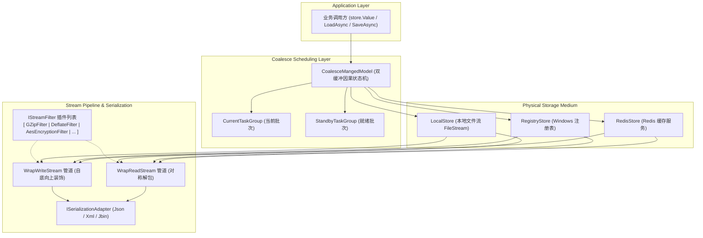

# ApeFree.DataStore 核心架构设计

## 1. 架构总览

`ApeFree.DataStore` 采用分层解耦与插件化设计，核心由 **持久化门面（Store Facade）**、**流式过滤器管道（Stream Filter Pipeline）**、**序列化适配器（Serialization Adapter）** 以及 **读写因果合并调度器（Coalesce Managed Model）** 四大子系统构成。



---

## 2. 流式过滤器管道（Decorator Pipeline）

在 3.0.0 重构中，彻底废除了旧版本中将序列化、压缩、加密固定绑定的三段式硬编码设计，全面采用**流式装饰器管道模式（Decorator Pipeline）**。

### 2.1 双向流过滤器接口
```csharp
public interface IStreamFilter : IDisposable
{
    // 写入时由顶向下包装输出流 (Push 模式)
    Stream WrapWriteStream(Stream outputStream);

    // 读取时由底向上包装输入流 (Pull 模式)
    Stream WrapReadStream(Stream inputStream);
}
```

### 2.2 零拷贝与自由编排优势
- **自由顺序**：用户可根据业务需求自由排列过滤器顺序（例如：先 GZip 压缩再 AES 加密，或者先加密再压缩）；
- **端到端纯流式**：数据在流过管道时实时转换并流向最终介质流，彻底消除了中间全量 `byte[]` 和 `MemoryStream` 堆分配，极大降低了大对象持久化时的 GC 压力；
- **无限扩展性**：支持随时插入哈希完整性校验、魔数包头注入、流速监控或 Base64 转换等自定义过滤器。
