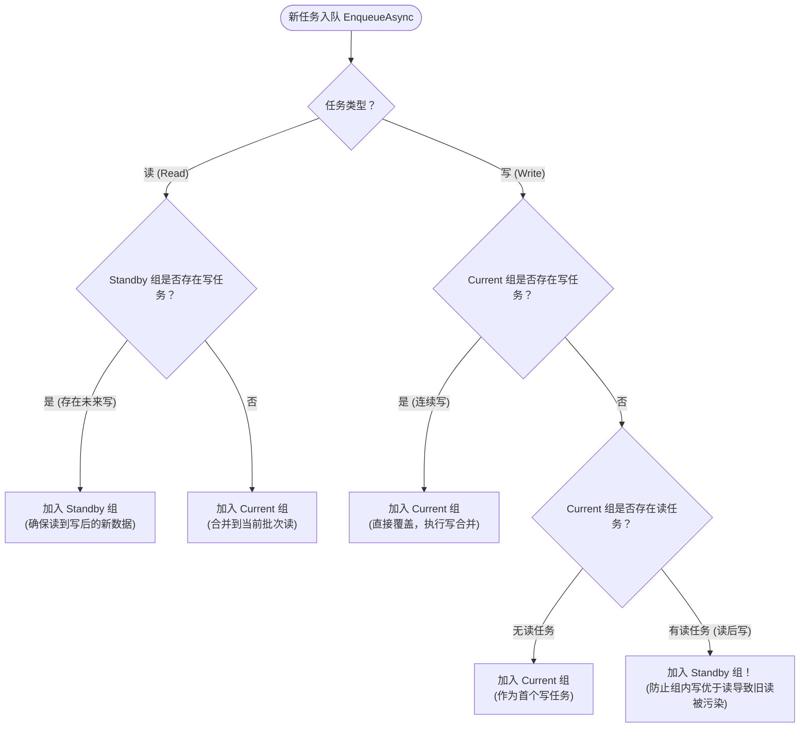

# CoalesceMangedModel 双缓冲写合并因果状态机

## 1. 产生背景

在桌面客户端、工控软件或游戏运行中，对象状态的变动往往极度频繁（如滑动条调节、多传感器并发采样、高频表单编辑）。如果每次调用 `SaveAsync()` 都直接执行物理写盘，会产生严重的 **IO 写放大** 与 **文件锁冲突**。

`CoalesceMangedModel` 专门为此场景设计，旨在实现：
1. **写折叠（Write Coalescing）**：将短时间内的 $N$ 次写入请求合并为单次最终物理 IO，大幅降低 IO 负载；
2. **因果一致性（Read-Your-Writes Consistency）**：写操作之后的读操作，**必须**读取到写操作落盘后的最新数据，杜绝时序倒置。

---

## 2. 状态机推导与路由逻辑

模型维护了两个相互翻转的任务批次：`currentTaskGroup`（当前就绪组）和 `standbyTaskGroup`（备用等待组）。

---

## 3. 3.0.0 版本的重大优化
- **非阻塞纯异步化**：彻底剔除了原有的 `AutoResetEvent.WaitOne()` 阻塞模型，全面升级为基于 `TaskCompletionSource<bool>` 的纯异步通知机制，零占用线程池线程；
- **原子互斥状态流转**：消费循环采用 `Interlocked.CompareExchange` 实现无锁互斥流转与双重防漏检查，彻底消除并发竞态。
